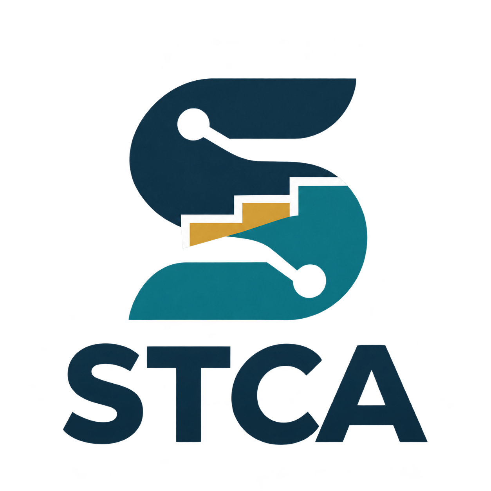

<p align="center"></p>

# STCA：DeepSeek Harness 版

从数据总结规则，使用已有规则筛选，或按规则生成新结构

**版本 0.1.0** · [English](https://github.com/foukusa/stca-agent-skill/blob/main/README.DSH.md)

[STCA 论文](https://doi.org/10.1038/s41524-026-02345-x) · [Python 程序库](https://github.com/foukusa/polymer-stca) · [其他平台安装](https://github.com/foukusa/stca-agent-skill/blob/main/README.zh-CN.md#下载与安装)

## 目录

- [安装与开始](#安装与开始)
- [选择任务](#选择任务)
- [数据列与星号连接点](#数据列与星号连接点)
- [数据划分与评价](#数据划分与评价)
- [试用范例](#试用范例)
- [现成规则与支持性质](#现成规则与支持性质)
- [运行环境与权限](#运行环境与权限)
- [许可与来源](#许可与来源)

## 安装与开始

1. 在 DSH 打开 **插件 → 添加插件**。
2. 在“包名、GitHub 仓库地址或本地目录路径”输入框中填写：

```text
github:foukusa/stca-agent-skill
```

3. 点击安装，完成后启用 STCA，再输入 `/stca` 或“开始使用 STCA”。

也可在终端通过 DSH CLI 安装：

```bash
dsh plugin --profile web add github:foukusa/stca-agent-skill
```

**这是从 GitHub 仓库安装插件，无需先发布 npm 包。** 仓库中已提供 `package.json`、插件入口和完整 skill 资源。不要将 `dsh plugin ...` 命令粘贴到这个图形界面输入框。

| 方式 | 在“添加插件”中填写 |
|---|---|
| **GitHub 仓库，当前推荐** | `github:foukusa/stca-agent-skill` |
| 下载插件 ZIP 后安装 | [插件 ZIP](https://github.com/foukusa/stca-agent-skill/blob/main/downloads/dsh-plugin-stca-0.1.0.zip)解压后，直接包含 `package.json` 的文件夹完整路径 |
| npm 包名，发布后可用 | `dsh-plugin-stca` |
| 插件中心 | —（上架后补充链接） |

<!-- DSH_PLUGIN_CENTER_URL: add the actual listing URL after publication. -->

在“添加插件”中使用上面的 `github:` 地址。若之前用 HTTPS 地址安装时出现“无法从依赖变更中确定安装了哪一个包”，改用此地址重试。已有 STCA 条目时先检查并启用；替换旧版时保留数据、结果和保存的规则。安装报错及可选 CLI 操作见[安装说明](https://github.com/foukusa/stca-agent-skill/blob/main/docs/INSTALL.zh-CN.md#deepseek-harness)。

本地目录方式是备选：打开插件 ZIP 文件页，点击 **Download raw file** 下载并解压，再填写完整目录路径。另有[独立 skill ZIP](https://github.com/foukusa/stca-agent-skill/blob/main/downloads/stca-deepseek-harness-0.1.0.zip)，用于手动放置含 `SKILL.md` 的完整 `stca` 文件夹，与插件目录的安装方式分开。

## 选择任务

STCA 通过当前 LLM 对话工作。你可以直接提出任务；只说“开始使用 STCA”时，AI 助手会介绍可选的三种用法。直接用自然语言说明目标即可。

| 选择 | 得到什么 | 可以直接说 |
|---|---|---|
| **上传数据总结规则** | 返回两种方法的结果与可用状态，保存可用规则并给出阈值和推荐 | “从这份聚合物热导率数据总结高值规则并保存。” |
| **用已有规则筛选** | 每条原始候选的判断、未满足的规则条件及入选表 | “先显示规则目录，用我选的规则筛选这份候选。” |
| **用已有规则生成** | 当前 LLM 按规则生成重复单元，再逐条核验结构条件 | “先选规则，再直接生成 20 个聚合物重复单元并核验。” |

完整处理 prompt 已内置。归纳时未指定百分比，就使用 Top 或 Bottom **10%、20%、30%**；也可自定其他合法百分比。每档返回具体阈值、比较符和单位。WRAcc 默认在训练数据内选择条件数上限；也可直接说“WRAcc 最多使用 10 条条件”或“不限制 WRAcc 条件数”。两种方法分别返回，并给出推荐。保留原始 SMILES 与重复单元连接点，H-cap 仅用于计算副本。

学习默认进行 **Morgan 距离外推评价**：使用 ECFP4（radius 2、2,048 位），保证每条评价结构到最近训练结构的 Tanimoto 距离 **≥ 0.5**。数据变换、扫描设置、规则选择与方法推荐只使用训练数据。相似性缓冲记录不参与训练或评价，原始表仍完整返回筛选结果。AI 助手分别报告两种方法的外推表现，以及每档由训练数据确定的具体物理阈值。

尚未指定规则时，AI 助手先显示可选规则目录。可选择**先预览，确认后生成**，查看并调整 prompt；也可选择**直接生成**。AI 助手会返回保存的规则文件和位置。接着说“用刚才保存的规则筛选这份候选”或“用这些规则生成”，即可继续。完整对话见[自然语言使用案例](https://github.com/foukusa/stca-agent-skill/blob/main/docs/USAGE.zh-CN.md)，现成结论见[规则目录](https://github.com/foukusa/stca-agent-skill/blob/main/docs/RULE_LIBRARY.zh-CN.md)。

## 数据列与星号连接点

总结规则必须明确绑定**结构列、数值性质列及单位**，可以在请求中直接指定。对于下面的ADEPT等已知范例，配置已给出列映射；自己的文件则先读取表头，并在学习前显示将使用的列名、目标含义和单位。如果同时有实测与计算密度、不同温度，或均值与最小／最大值等多个可能目标，会先请你选择。你明确指定的列名优先；不能只看数值范围判断哪列是密度。使用已有规则筛选候选只需结构列，不要求候选已有性质标签。

上传原始重复单元 SMILES 时，**保留其中的 `*` 连接点**。STCA 保存这份原文，另建计算副本：把支持的末端单键连接点用氢封端（**H-cap**），再计算指纹。ECFP4 用于定义结构距离，MACCS167 用于表达规则条件。返回结果时使用保存的原始 SMILES，`*` 的位置与输入一致。这里不是字符串替换，也不从封端分子反推连接点。已经封端的输入保持原样，不凭空补星号。

| 上传的原始结构 | H-cap 计算副本 | 返回的结构 |
|---|---|---|
| `*CCO*` | `CCO` | `*CCO*` |

## 数据划分与评价

结构距离使用 **ECFP4**：对 H-cap 计算副本生成 radius=2、2,048 位 Morgan 指纹，**距离 = 1 − Tanimoto 相似度**。相同原始结构及相同 H-cap 副本保持在同一保护组。

| 分区或评价 | 具体做法 |
|---|---|
| **内推区域（interpolation）** | 在这里归纳规则，选择数据变换、扫描步长及支持量。 |
| **外推区域（extrapolation）** | 使用性质标签前，先在结构空间外围选择一个邻域，目标约占有效结构记录的 20%；每条外推结构到 interpolation 区域的最近邻距离均 **≥0.5**。 |
| **相似性缓冲区** | 将与 extrapolation 区域距离不足 0.5 的其他结构组隔离，不训练、不外评，但仍返回筛选结果。 |
| **内推范围内评价** | 在 interpolation 区域中按保护结构组进行 5 折、3 次重复交叉验证；结果基于该区域的数据准备，不是另设的独立内推测试集。 |

这样划分是为了防止相同或近邻结构跨越 interpolation 与 extrapolation 边界，检验规则向不同聚合物结构的迁移能力。推荐方法由 **interpolation 区域内部的另一层 Morgan 距离验证**确定，再评价 extrapolation 区域；冻结后的阈值与规则保持不变。详见[评价说明](https://github.com/foukusa/stca-agent-skill/blob/main/docs/MORGAN_EVALUATION.zh-CN.md)。

## 试用范例

下载 [ADEPT `BANDGAP_DFT.csv`](https://github.com/sobinalosious/PolyGraphMT/blob/1c51a8578b6d23bd45bae7f7e175516dc22a3ed9/data/raw/BANDGAP_DFT.csv)，上传到对话。文件有 **2,916 条记录、两列**，目标是**氢封端孤立单体的 DFT HOMO–LUMO 能隙**，单位 eV。

| 用途 | 列名 | 表格位置 |
|---|---|---|
| 重复单元结构 | `SMILES` | A · 第 1 列 |
| 孤立单体能隙 | `BANDGAP` | B · 第 2 列 |

第1行是表头，第 **2–2917行**是数据；全部数据行作为输入，无需标识列。

**使用已有 STCA 规则筛选：**

```text
使用已有的 ADEPT 高孤立单体 HOMO–LUMO 能隙 Top 30% STCA 规则筛选这份文件。
```

冻结目标为**能隙 ≥ 11.914537535 eV**。这份文件应返回 **976条匹配、1,940条未匹配、0条未知**。在584条独立 Morgan 距离留出记录上，该 STCA 规则的**精确率为0.7500、召回率为0.7784、F1为0.7639、马修斯相关系数为0.6517**。原表匹配数量与独立评价分别返回。

**重新总结规则、筛选并保存：**

```text
从这份 ADEPT 文件总结高孤立单体 HOMO–LUMO 能隙 Top 30% 规则。结构列为 SMILES，性质列为 BANDGAP，单位 eV。使用全部数据行，返回两种方法、外推评价和筛选结果，并保存规则。
```

AI助手在训练部分学习 STCA 与 WRAcc，分别交付结果。接着说**“重新载入刚保存的 Top 30% STCA 规则，再筛选同一份文件。”**，每行判断应与之前一致。

**按选定规则生成：**

```text
使用刚保存的 Top 30% STCA 规则，直接生成5个聚合物重复单元并核验。
```

想先调整，可说**“生成前先给我看完整 prompt。”**，修改后回复**“确认，开始生成。”**。当前LLM实际生成候选，STCA逐条核验精确结构条件。详见[完整 ADEPT 范例](https://github.com/foukusa/stca-agent-skill/blob/main/examples/adept_gap/README.zh-CN.md)和[生成提案](https://github.com/foukusa/stca-agent-skill/blob/main/examples/adept_gap/generated_examples.csv)。

## 现成规则与支持性质

[规则目录](https://github.com/foukusa/stca-agent-skill/blob/main/docs/RULE_LIBRARY.zh-CN.md)包含论文Tg/电导率规则、气体渗透率、RadonPy与ADEPT性质，以及 **OpenPoly水接触角Top10%、20%、30%**规则。按来源、性质、百分比和方法选择后，即可筛选候选；目录提供各档阈值、规则条件和筛选评价。

## 运行环境与权限

- DSH 版本要求：**`>=0.0.1-rc.3 <0.3.0`**。
- 计算使用 **CPU 与 Python 3.10 及以上环境**。筛选和结构核验需要 RDKit，学习还使用数值计算依赖。STCA 自动查找并检查普通 Python、虚拟环境或 Conda 环境，**不要求安装 Conda，也不要求手工填写 Python 路径**。优先复用兼容环境，缺少依赖时可在用户缓存中准备独立环境。
- 当前 DSH 会话需允许读取指定数据、写入结果目录及执行本地命令。原输入保留，结果另存；查询规则和读取现成 prompt 不需要 RDKit。计算环境无法运行时，生成提案会标为“待核验”，不会据此把结构记为无效或规则不匹配。
- 包内已包含经校验的作者实现，普通计算无需 Git，也不再克隆源码；准备缺失的 Python 依赖时可能访问 PyPI。生成使用当前 DSH 会话已配置的模型／服务商，STCA 无需另配模型 API；数据处理仍遵循当前会话与服务商的规则。

## 许可与来源

这是社区开发的 STCA 集成，与 DeepSeek AI 无官方隶属关系。源码采用 **[STCA Agent Skill Academic Use License](https://github.com/foukusa/stca-agent-skill/blob/main/LICENSE)**：允许非商业学术研究、教育与科学结果复现；商业使用和再分发需事先获得书面许可。第三方组件保留[各自的声明与条款](https://github.com/foukusa/stca-agent-skill/blob/main/THIRD_PARTY_NOTICES.md)。

**Weihao Wang** · [STCA 论文](https://doi.org/10.1038/s41524-026-02345-x) · [原始实现](https://github.com/foukusa/polymer-stca) · [完整项目说明](https://github.com/foukusa/stca-agent-skill/blob/main/README.zh-CN.md) · [ORCID](https://orcid.org/0009-0005-4445-7074) · [ResearchGate](https://www.researchgate.net/profile/Weihao-Wang-23) · [Google Scholar](https://scholar.google.com/citations?user=d9WIMyMAAAAJ)

<p align="center"><em>化繁为简，拨云见日</em></p>
