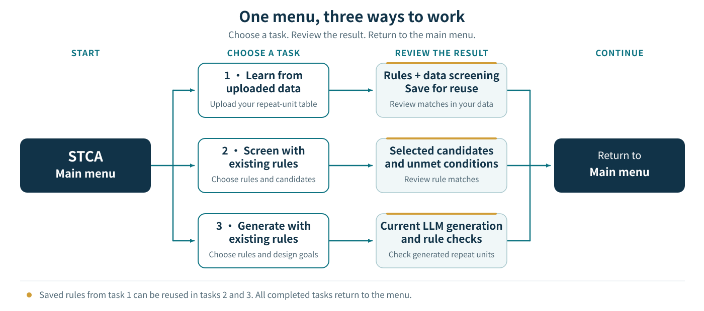

<p align="center"></p>
<h1 align="center">STCA Agent Skill</h1>
<p align="center">Interpretable polymer screening, rule extraction, and rule-guided candidate verification with Sliding Threshold Correlation Analysis.</p>
<p align="center"><strong>0.1.0</strong> · English · <a href="README.zh-CN.md">简体中文</a></p>
<p align="center"><a href="https://doi.org/10.1038/s41524-026-02345-x">STCA paper</a> · <a href="https://github.com/foukusa/polymer-stca">Python library</a> · <a href="#download-and-install">Install the skill</a></p>

## Contents

- [Start here](#start-here)
- [Try ADEPT gap data](#try-adept-gap-data)
- [Save rules and continue](#save-rules-and-continue)
- [Natural-language examples after installation](docs/USAGE.md)
- [Download and install](#download-and-install)
- [DeepSeek Harness guide](README.DSH.md)
- [Existing rules and generation prompts](#existing-rules-and-generation-prompts)
- [Prepare your data](#prepare-your-data)
- [Data splitting and evaluation](#data-splitting-and-evaluation)
- [Paper and author](#paper-and-author)

## Start here

STCA works with polymer structure–property data and repeat units. After installation, say **“Start STCA”** or describe the task you want to complete. See the [natural-language examples](docs/USAGE.md) for complete conversations:

| Task | Goal | A short request |
|---|---|---|
| **Upload data and learn rules** | Learn rules and return their screening results | “Learn high thermal-conductivity rules from this data.” |
| **Screen with existing rules** | Use bundled rules or your saved rules | “Screen this candidate table with existing rules.” |
| **Generate with existing rules** | Choose rules, then preview and confirm the prompt or generate directly | “Generate 20 candidates directly with this rule.” |

STCA is a skill used by your AI assistant in the conversation. The task instructions are built in: describe what you need, attach your data when needed, and continue in natural language. The assistant reads files, offers relevant rules and asks only for missing information. When learning rules, omitted percentages use Top or Bottom **10%, 20% and 30%** automatically; you can specify any percentage strictly between 0% and 100%, such as **15% and 25%**. You do not enter rule IDs or manage Python. Calculations use a CPU and support Python 3.10 or later; generation uses your current AI assistant.

Before learning, the assistant states the **structure column, property column, unit and direction** it will use. Known datasets have built-in column mappings; for your own table, you can name the columns directly. If several columns could represent the target, such as measured density, computed density or density at different temperatures, it asks you to choose before learning. See [Prepare your data](#prepare-your-data).

## Try ADEPT gap data

Download [ADEPT `BANDGAP_DFT.csv`](https://github.com/sobinalosious/PolyGraphMT/blob/1c51a8578b6d23bd45bae7f7e175516dc22a3ed9/data/raw/BANDGAP_DFT.csv) and upload it to the conversation. This file has **2,916 records and two columns**. The target is the **DFT HOMO–LUMO gap of a hydrogen-capped isolated monomer**, in eV.

| Use | Column | Spreadsheet position |
|---|---|---|
| Repeat-unit structure | `SMILES` | A · column 1 |
| Isolated-monomer gap | `BANDGAP` | B · column 2 |

Row 1 is the header; rows **2–2917** contain data. Use all rows as input. No identifier column is required.

**Screen with the existing STCA rule:**

```text
Use the existing ADEPT high isolated-monomer HOMO–LUMO gap Top 30% STCA rule to screen this file.
```

The frozen target is **gap ≥ 11.914537535 eV**. This file produces **976 matches, 1,940 non-matches and no unknowns**. On 584 independent Morgan-distance holdout records, the STCA rule has **precision 0.7500, recall 0.7784, F1 0.7639 and Matthews correlation coefficient 0.6517**. Full-table matches and independent evaluation are reported separately.

**Learn rules, screen and save:**

```text
Learn high isolated-monomer HOMO–LUMO gap Top 30% rules from this ADEPT file. Use SMILES for structures and BANDGAP for the target, in eV. Use all input rows, return both methods, extrapolation evaluation and screening results, and save the rules.
```

The assistant learns STCA and WRAcc from the training partition and returns both results. Continue with **“Reload the Top 30% STCA rule just saved and screen the same file.”** Every row must match its previous decision.

**Generate with the selected rule:**

```text
Use the Top 30% STCA rule just saved to directly generate and verify five polymer repeat units.
```

To adjust the prompt first, say **“Show the complete generation prompt before generating.”** After your edits, say **“Confirm and generate.”** The current LLM proposes candidates and STCA verifies their exact structural conditions. See the [complete ADEPT example](examples/adept_gap/README.md) and [generated proposals](examples/adept_gap/generated_examples.csv).

## Save rules and continue

Learning returns STCA and WRAcc separately, with a recommendation for each tier. Recommendations use training-side validation and the average of **Matthews correlation coefficient, precision and F1 score**, as defined in the author’s [STCA paper](https://doi.org/10.1038/s41524-026-02345-x). Say “Use the recommended rule” or name a method. [Data splitting and evaluation](#data-splitting-and-evaluation).

WRAcc automatically chooses its maximum condition count within the training data. You can also say **“Allow up to 10 WRAcc conditions”** or **“Do not limit the number of WRAcc conditions.”**

After learning, it returns **both methods’ results and rule availability for every tier**: the percentage and its **numeric physical cutoff, ≥/≤ comparison and unit**, original SMILES, selection decisions, every unmet rule condition and uncomputable records. Cutoffs use the original physical scale even when learning uses log10. Results always cover the original uploaded table; a separate candidate table receives its own results.

The assistant saves available models, rules, physical cutoffs and complete bilingual generation prompts as files, and reports their names and locations. Continue by saying **“Use the rules you just saved to screen this table”** or **“Use the saved gap rule to generate 20 repeat units.”** Download the rule bundle for use in a new session or on another platform; availability of local files depends on the current workspace.



When you ask to generate with existing rules, STCA **shows the available rule catalog first**, including bundled rules and saved rule bundles loaded in the conversation. Choose a source, property and percentage, then choose how to generate:

- **Preview and confirm**: view the complete prompt, adjust the candidate count, structural preferences or output format, then say “Confirm and generate.” The current LLM generates only after your confirmation.
- **Generate directly**: the current LLM uses the selected rules immediately to generate candidates and verify every proposal.

Both modes return the original proposals and polymer SMILES, followed by the computed rule checks and unmet conditions. If calculation cannot run, the output identifies the proposals as awaiting verification. If your request already says “generate directly,” STCA uses that mode. Changes to the target or frozen rule conditions require choosing and confirming the corresponding rule. No additional LLM API setup is needed.

You can continue with another task directly, or say **“What can I do next?”** to see the available actions. To reuse saved rules on another device or platform, upload the rule bundle in the new conversation.

## Download and install

Choose your platform below. The [installation guide](docs/INSTALL.md) includes environment behavior and alternative installation paths.

| Platform | Installation route | Start |
|---|---|---|
| **Codex** | Install the GitHub skill folder or the [Codex ZIP](https://github.com/foukusa/stca-agent-skill/blob/main/downloads/stca-codex-0.1.0.zip). | `Use $stca` |
| **DeepSeek Harness** | Enter the GitHub installation address below in Add plugin; npm publication is not required. | `/stca` |
| **WorkBuddy** | Import the [WorkBuddy ZIP](https://github.com/foukusa/stca-agent-skill/blob/main/downloads/stca-workbuddy-0.1.5.zip). | “Start STCA” |
| **ChatGPT** | Import the [OpenAI skill ZIP](https://github.com/foukusa/stca-agent-skill/blob/main/downloads/stca-openai-skill-0.1.0.zip) using a client with skill installation support. | Select STCA or ask to use it. |

### Codex

1. In Codex, send the installation request below.
2. After installation, type `$stca` to select STCA, or send “Use $stca to screen this candidate table.” Attach the table when needed.
3. For a manual installation, extract the Codex ZIP and put its complete `stca` folder at `~/.agents/skills/stca`. Keep `SKILL.md`, `scripts`, `references` and `assets` together.

```text
Use $skill-installer to install https://github.com/foukusa/stca-agent-skill/tree/main/skills/stca
```

### DeepSeek Harness

1. Open **Plugins → Add plugin**.
2. Enter this **GitHub installation address** and click Install:

```text
github:foukusa/stca-agent-skill
```

3. Enable STCA, then enter `/stca` or say “Start STCA”. Describe the task and attach data when needed.

Alternatively, install from the terminal with the DSH CLI:

```bash
dsh plugin --profile web add github:foukusa/stca-agent-skill
```

**Installing from GitHub does not require npm publication.** DSH reads the plugin configuration and entry from the public repository. Entering only `dsh-plugin-stca` requires that package to have been published on npm; use the repository URL until then.

If STCA is already listed, check and enable that entry instead of repeatedly adding it. See [DSH installation](docs/INSTALL.md#deepseek-harness) for installation errors, optional CLI use and the [plugin ZIP](https://github.com/foukusa/stca-agent-skill/blob/main/downloads/dsh-plugin-stca-0.1.0.zip) local-directory fallback. The separate [standalone skill ZIP](https://github.com/foukusa/stca-agent-skill/blob/main/downloads/stca-deepseek-harness-0.1.0.zip) is extracted into a DSH skill directory; it is different from the plugin root used by Add plugin. See the [DSH guide](README.DSH.md).

Plugin-center link: — (to be added after listing).

<!-- DSH_PLUGIN_CENTER_URL: add the actual listing URL after publication. -->

### WorkBuddy

1. Download `stca-workbuddy-0.1.5.zip` from the table above.
2. Open WorkBuddy’s skill management page and choose the action to add/upload a local skill package. Select the ZIP directly, complete import and enable **STCA Polymer Rules and Design**.
3. Say “Start STCA”, attach your file, then describe whether you want to learn rules, screen candidates or generate repeat units.

The marketplace installation link will be added after approval and publication. Use a separate task folder; WorkBuddy keeps STCA runtime files and results there. If a file operation is denied, the assistant reports the blocked step and preserves completed results. See [permission troubleshooting](docs/INSTALL.md#workbuddy-file-permissions).

### ChatGPT

1. Download `stca-openai-skill-0.1.0.zip` from the table above.
2. In a ChatGPT client that supports skill installation, use its import option or upload the package and ask to install the STCA skill.
3. Once STCA appears among the available skills, select it or say “Use STCA to screen this table.” Calculations require file access and code execution in that client. If skill installation is unavailable in your client, use one of the other platforms above.

### Downloading the files

The ZIP and TGZ links open file pages in this repository’s [`downloads` folder](https://github.com/foukusa/stca-agent-skill/tree/main/downloads). On a file page, click **Download raw file** to save the package, then import the local file in your platform. You can also open the [repository homepage](https://github.com/foukusa/stca-agent-skill), choose **Code → Download ZIP**, and extract it. The source contains `skills/stca`; platform packages are under `downloads` when included in that repository version. A source ZIP is extracted before folder-based installation; WorkBuddy’s upload accepts its platform ZIP directly.

At the first calculation, STCA looks for and checks a suitable local Python environment. You can use ordinary Python or a virtual environment; Conda is optional. The assistant needs access to your selected files, an output directory and local command execution. The checked author implementation is included in the package, so ordinary calculations do not clone a Git repository. Preparing missing Python dependencies may access PyPI; generation uses the current conversation’s LLM. See [environment behavior](docs/INSTALL.md#calculation-environment).

## Existing rules and generation prompts

The [rule and prompt directory](docs/RULE_LIBRARY.md) offers **source → property → percentage** choices. You can also load a rule bundle learned from your own data. The open-data library includes gas permeability, bulk polymer properties and water contact angle; the catalog identifies the available percentages, both methods and their recommendations. Frozen Tg and electrical-conductivity rules from the author’s STCA paper are also included.

| Source | Properties |
|---|---|
| [STCA paper](https://doi.org/10.1038/s41524-026-02345-x) | High Tg, low electrical conductivity, high electrical conductivity |
| [GAS measured data](https://github.com/jsunn-y/PolymerGasMembraneML) | CO₂ and O₂ permeability |
| [RadonPy computed data](https://github.com/RadonPy/RadonPy/blob/db5732b7fdd0b656d9c06d89151066d1edfbe911/data/PI1070.csv) | Thermal conductivity, refractive index, density, specific heat, dielectric constant |
| [ADEPT computed data](https://github.com/sobinalosious/PolyGraphMT/tree/1c51a8578b6d23bd45bae7f7e175516dc22a3ed9/data/raw) | Thermal conductivity, density, isolated-monomer HOMO–LUMO gap, dielectric constant, refractive index |
| [OpenPoly literature data](examples/water_contact_angle/README.md) | Water contact angle |

The library also supports water-contact-angle Top **10%, 20% and 30%** structural screening. The [RadonPy density example](examples/radonpy_density/README.md) remains available for other use cases.

The catalog shows each tier’s **method, rule availability, recommendation and numeric physical cutoff with its comparison and unit**. Accept the recommendation or choose an available method; available rule sets are applied separately. A percentage absent from the selected frozen catalog, such as 15% or 25% in the open-data library, requires labelled data to learn a new rule. Existing percentages are never interpolated or substituted. If you only want a prompt for another LLM, ask for the complete prompt without generation.

The Tg and electrical-conductivity rules implement the experimental-property screening tasks presented in the author’s STCA paper. STCA has also been used with GAS, RadonPy, ADEPT and OpenPoly datasets for rule extraction and screening validation. Choose rules matching your objective, or learn from your own data. See the [rule directory](docs/RULE_LIBRARY.md#stca-paper-rules), [dataset sources](examples/open_data/dataset_registry.csv) and [application examples](examples/open_data/README.md).

## Prepare your data

### Specify the structure and property columns

**Screening with existing rules needs a structure column; learning also requires an explicitly bound numeric property column and unit.** Identifiers are optional and may have any name; they are not learning features. Columns are bound by their header names; spreadsheet positions only help locate them.

For your own data, you can say:

```text
Use STCA to learn high-density rules. The structure column is SMILES and the property column is Density, in g/cm³. Use all data rows, return screening results and save the rules.
```

Before learning, the assistant states the file, row count, structure column, property column, unit and direction. A unique, clear mapping can be used automatically. Multiple possible targets, duplicate headers or unclear units require clarification first. The ADEPT example binds `SMILES` and `BANDGAP`, with eV as the unit. Your explicitly named columns take priority. You can also request that an existing data split be preserved.

### Star input, H-cap calculation, star output

Upload polymer repeat units with their **original `*` attachment points; you do not need to cap them yourself**. Processing follows these steps:

| Stage | Example SMILES | What happens |
|---|---|---|
| Input | `*CCO*` | Preserve the original repeat unit and attachment-point positions |
| Calculation | `CCO` | Replace terminal, single-bonded `*` attachment atoms with hydrogen in a calculation copy, then compute fingerprints |
| Output | `*CCO*` | Return the preserved original star-containing SMILES, with its attachment positions and labels intact |

**Original `*` input → H-cap calculation copy → original `*` output.** ECFP4 fingerprints define structural distance; MACCS167 fingerprints encode the conditions used in STCA and WRAcc rules. The H-cap copy does not overwrite the original SMILES. Screening and verification of generated proposals follow this same process. Already capped input without `*` is processed and returned as supplied.

A candidate-only screening CSV can contain:

```csv
CandidateKey,SMILES
sample-A7,*CCO*
42-blue,*CC*
```

For learning, add the corresponding numeric property column on each row and state whether its labels are measured or computed.

## Data splitting and evaluation

Structural distance uses **ECFP4**: 2,048-bit Morgan fingerprints with radius 2, calculated from the H-cap copy; **distance = 1 − Tanimoto similarity**. Identical original structures and identical H-cap copies stay in the same protected group.

| Partition or evaluation | How it is used |
|---|---|
| **Training (`source`)** | Learn rules and choose data transforms, scan steps and support using this partition only. |
| **Independent extrapolation (`holdout`)** | Select a peripheral structural neighborhood, targeting 20% of structurally valid records, before using target labels. Every holdout structure has nearest-source distance **≥0.5**. |
| **Similarity buffer** | Keep groups closer than 0.5 to the holdout out of training and evaluation. They remain in the returned screening table. |
| **Within-range diagnostic** | Protected-group 5-fold cross-validation, repeated three times within source. This is a diagnostic conditional on source preparation, not a separate distance-defined interpolation test. |

This design keeps identical and nearby structures from bridging the training–holdout boundary and tests whether rules transfer to structurally different polymers. A further Morgan-distance validation **inside source** selects the recommended method before the outer holdout is evaluated. Frozen source thresholds and rules are then applied unchanged. See [evaluation details](docs/MORGAN_EVALUATION.md).

## Paper and author

**Weihao Wang** — [STCA paper](https://doi.org/10.1038/s41524-026-02345-x) · [Original implementation](https://github.com/foukusa/polymer-stca) · [Cite this software](CITATION.cff)

Try the [STCA simplified reproduction version on Code Ocean](https://doi.org/10.24433/CO.1601774.v1) to view the code and data and run the examples online.

[ORCID](https://orcid.org/0009-0005-4445-7074) · [ResearchGate](https://www.researchgate.net/profile/Weihao-Wang-23) · [Google Scholar](https://scholar.google.com/citations?user=d9WIMyMAAAAJ)

The source is publicly available under the **STCA Agent Skill Academic Use License** for non-commercial academic research, education and scientific reproduction. Commercial use and redistribution require prior written permission. See [LICENSE](LICENSE) and [THIRD_PARTY_NOTICES.md](THIRD_PARTY_NOTICES.md).

<p align="center"><em>“Out of clutter, find simplicity.”</em><br><sub>— attributed to Albert Einstein</sub></p>
