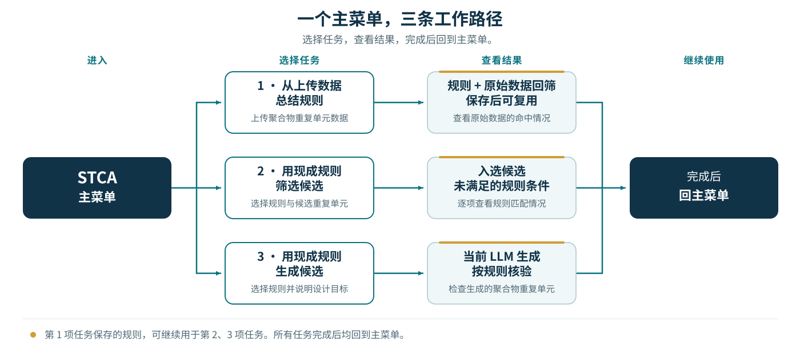

<p align="center"></p>
<h1 align="center">STCA Agent Skill</h1>
<p align="center">从聚合物结构与性质数据总结规则，筛选候选，或按规则生成重复单元。</p>
<p align="center"><strong>0.1.0</strong> · <a href="README.md">English</a> · 简体中文</p>

## 目录

- [开始使用](#开始使用)
- [用 RadonPy 密度数据试用](#用-radonpy-密度数据试用)
- [保存规则并继续](#保存规则并继续)
- [安装后的自然语言使用案例](docs/USAGE.zh-CN.md)
- [下载与安装](#下载与安装)
- [DeepSeek Harness 专用说明](README.DSH.zh-CN.md)
- [现成规则与生成 prompt](#现成规则与生成-prompt)
- [准备数据](#准备数据)
- [论文与作者](#论文与作者)

## 开始使用

STCA 面向聚合物结构与性质数据。安装后输入 **“开始使用 STCA”**，或直接说明要完成的任务。完整对话范例见[自然语言使用案例](docs/USAGE.zh-CN.md)：

| 任务 | 做什么 | 简短请求 |
|---|---|---|
| **上传数据总结规则** | 学习规则并返回对应筛选结果 | “从这份数据总结高热导率规则。” |
| **用已有规则筛选** | 使用内置规则或自己保存的规则 | “用已有规则筛选这份候选表。” |
| **用已有规则生成** | 选规则后，预览确认 prompt 或直接生成 | “用这条规则直接生成 20 个候选。” |

STCA 是由当前 AI 助手在对话中使用的 skill，处理流程已内置。直接说明需求，按需上传数据，再用自然语言继续；AI 助手会读取文件、展示相关规则，并补问必要信息。归纳规则时，未指定百分比就直接使用 Top 或 Bottom **10%、20%、30%**；也可指定 0% 与 100% 之间的任意百分比，例如 **15%、25%**。你无需输入规则编号或操作 Python。计算使用 CPU，兼容 Python 3.10 及以上环境，生成使用当前 AI 助手。

开始学习前，AI 助手会说明本次使用的**结构列、性质列、单位及高低方向**。已知数据集按内置配置匹配；自己的表格可直接指定列名。若多个列都可能是目标，例如实测密度、计算密度或不同温度下的密度，会先请你选择，再开始学习。详见[准备数据](#准备数据)。

## 用 RadonPy 密度数据试用

使用同一份 [RadonPy `PI1070.csv`](https://github.com/RadonPy/RadonPy/blob/db5732b7fdd0b656d9c06d89151066d1edfbe911/data/PI1070.csv) 完成筛选、学习和生成。在 GitHub 文件页下载 CSV，再上传到对话。这份固定文件有 **1,077 条记录、157 列**；AI 助手按列名读取，你无需手工拆分这个集成数据集。

| 用途 | 列名 | 表格位置 |
|---|---|---|
| 可选标识 | `monomer_ID` | A 列 · 第 1 列 |
| 聚合物重复单元结构 | `smiles` | B 列 · 第 2 列 |
| 密度目标，g/cm³ | `density` | AA 列 · 第 27 列 |

第 1 行是表头，**第 2–1078 行**是数据，先读取全部记录。`polymer_class` 是元数据，`density_min`、`density_max`、`density_std`、`density_count` 不作为目标列。密度标签来自分子动力学计算。

**直接使用已有规则筛选：**

```text
使用现成的 RadonPy 高密度 Top 30% STCA 规则筛选这份数据。
```

这个固定文件应返回 **137 条规则匹配、940 条未匹配、0 条未知**；规则的密度目标边界为 **≥ 1.222343047 g/cm³**。

**从同一数据总结规则并保存：**

```text
从这份 RadonPy 数据总结高密度 Top 30% 规则。结构列为 smiles，性质列为 density，单位 g/cm³，使用全部数据行。返回筛选结果，与现成规则比较，并保存新规则。
```

AI 助手自动选择数据形式与扫描步长，分别返回 STCA 和 WRAcc 结果。固定相同的训练数据、预处理、指纹、学习设置与程序版本时，重新计算应得到相同规则；重新自适应学习可能与现成冻结规则不同。要核对保存复用，可接着说 **“重新载入刚保存的 Top 30% STCA 规则，再筛选同一份数据。”** 逐行判断应与这条规则学习完成时的筛选结果一致。

**使用选定规则生成：**

```text
使用刚保存的高密度 Top 30% STCA 规则，直接生成 5 个聚合物重复单元并核验。
```

想先调整 prompt，可说 **“先给我看生成 5 个重复单元的完整 prompt，暂不生成。”** 修改后回复 **“确认，开始生成”**。当前 LLM 实际生成提案，STCA 保留原始星号结构，并用 H-cap 计算副本逐条核验。详见[完整 RadonPy 案例](examples/radonpy_density/README.zh-CN.md)。

也可查看[一次实际生成的五条提案及核验结果](examples/radonpy_density/generated_examples.csv)。

## 保存规则并继续

上传自己的数据后，STCA 自动清理不可用记录、调整数据形式与扫描设置，并在你的数据范围内比较 **STCA 与 WRAcc**。两种方法分别交付，每档明确推荐结果及理由。推荐依据数据内部的**交叉验证**：多次用部分数据学习规则，再用其余数据评价。综合得分采用作者 [STCA 论文](https://doi.org/10.1038/s41524-026-02345-x)提出并验证使用的**马修斯相关系数、精确率和 F1 分数的平均值**；F1 综合衡量精确率与召回率。说“使用推荐规则”即可继续，也可明确指定方法。[评价方式说明](docs/USAGE.zh-CN.md)。

WRAcc 默认在训练数据内自动选择条件数上限。也可以直接说 **“WRAcc 最多使用 10 条条件”** 或 **“不限制 WRAcc 条件数”**。

总结完成后，同时交付**两种方法在每个档位的规则与对应筛选结果**：包含百分比对应的**具体物理数值、≥／≤ 比较符及单位**，以及原始 SMILES、入选判断、每条未满足的规则条件及不可计算记录。即使用 log10 归纳，也返回原始物理尺度的阈值。原上传表始终返回逐档结果；另传独立候选表时，其结果另列。

AI 助手将模型、规则、物理阈值和完整中英文生成 prompt 保存为文件，并报告文件名与位置。接着说 **“用刚才保存的规则筛选这份表”**，或 **“用刚才的高密度规则生成 20 个重复单元”**，即可继续。需要在新会话或其他平台复用时，下载并携带规则包；本地文件能否长期保留取决于当前工作区。



提出“用已有规则生成”时，STCA **先显示可选规则目录**，包括内置规则和本次对话已载入的规则包。选定来源、性质与百分比后，再选择生成方式：

- **先预览，确认后生成**：展示完整 prompt，可调整候选数量、结构偏好或输出格式；你回复“确认，开始生成”后，当前 LLM 才生成候选。
- **直接生成**：当前 LLM 立即按选定规则生成候选，并逐条核验。

两种方式都会返回原始提案和聚合物 SMILES，再给出实际计算的规则核验与未满足条件。无法执行计算时，会明确标为待核验。请求中已说明“直接生成”时，就直接使用该方式。修改目标或冻结规则条件时，会重新选择并确认对应规则。无需另外配置 LLM API。

可以直接提出下一项任务，或说 **“接下来可以做什么？”**，让 AI 助手说明可继续的操作。换设备或平台时，在新对话中上传已保存的规则包即可复用。

## 下载与安装

按所用平台安装。下方分别列出步骤，[安装说明](docs/INSTALL.zh-CN.md)还提供环境处理方式与其他安装路径。

| 平台 | 安装方式 | 调用 |
|---|---|---|
| **Codex** | 安装 GitHub 中的 skill 目录，或使用 [Codex ZIP](https://github.com/foukusa/stca-agent-skill/blob/main/downloads/stca-codex-0.1.0.zip)。 | `使用 $stca` |
| **DeepSeek Harness** | 在“添加插件”中填写 GitHub 仓库地址；npm 发布后也可填写包名。 | `/stca` |
| **WorkBuddy** | 导入 [WorkBuddy ZIP](https://github.com/foukusa/stca-agent-skill/blob/main/downloads/stca-workbuddy-0.1.1.zip)。 | “开始使用 STCA” |
| **ChatGPT** | 在支持 skill 安装的客户端中导入 [OpenAI skill ZIP](https://github.com/foukusa/stca-agent-skill/blob/main/downloads/stca-openai-skill-0.1.0.zip)。 | 选择 STCA 或要求使用 STCA。 |

### Codex

1. 在 Codex 中发送下方安装请求。
2. 安装完成后，输入 `$stca` 选择 STCA，或直接说“使用 $stca 筛选这份候选表”，按需附上文件。
3. 如需手动安装，解压 Codex ZIP，将完整 `stca` 文件夹放在 `~/.agents/skills/stca`。保留其中的 `SKILL.md`、`scripts`、`references` 和 `assets`。

```text
使用 $skill-installer 安装 https://github.com/foukusa/stca-agent-skill/tree/main/skills/stca
```

### DeepSeek Harness

1. 打开 **插件 → 添加插件**，填写 `https://github.com/foukusa/stca-agent-skill.git`，安装并启用。
2. 输入 `/stca` 或“开始使用 STCA”，说明任务，按需上传数据，在同一对话中继续。
3. npm 发布后，“添加插件”也可填写 `dsh-plugin-stca`；或下载[插件 TGZ](https://github.com/foukusa/stca-agent-skill/blob/main/downloads/dsh-plugin-stca-0.1.0.tgz)，填写其完整本地路径。

使用 DSH CLI、`web` profile 时：

```bash
dsh plugin --profile web add github:foukusa/stca-agent-skill
```

npm 发布后：

```bash
dsh plugin --profile web add dsh-plugin-stca
```

`web` 替换为自己实际使用的 profile。另有[本地 DSH skill ZIP](https://github.com/foukusa/stca-agent-skill/blob/main/downloads/stca-deepseek-harness-0.1.0.zip)：解压后，将完整 `stca` 文件夹放入 DSH 的 skill 目录，通常为 `~/.dsh/skills/stca`，并启用 filesystem skill provider。详见 [DSH 专用说明](README.DSH.zh-CN.md)。

插件中心链接：—（上架后补充）。

<!-- DSH_PLUGIN_CENTER_URL: add the actual listing URL after publication. -->

### WorkBuddy

1. 从上表下载 `stca-workbuddy-0.1.1.zip`。
2. 打开 WorkBuddy 的 skill 管理页面，选择添加／上传本地 skill 包，直接选择 ZIP，完成导入并启用 **STCA Polymer Rules and Design**。
3. 输入“开始使用 STCA”，上传文件，再说明要总结规则、筛选候选还是生成重复单元。

商店安装链接将在审核通过并发布后补充。

### ChatGPT

1. 从上表下载 `stca-openai-skill-0.1.0.zip`。
2. 在支持安装 skill 的 ChatGPT 客户端中，通过导入入口加载；也可上传安装包并要求“请安装这个 STCA skill”。
3. STCA 出现在可用 skill 中后，选择它或说“使用 STCA 筛选这份表”。计算还需要客户端提供文件访问和代码执行能力。如果当前客户端没有 skill 安装能力，使用上面的其他平台。

### 下载文件

ZIP 和 TGZ 链接均指向本仓库 [`downloads` 目录](https://github.com/foukusa/stca-agent-skill/tree/main/downloads)内的文件页。打开后点击 **Download raw file** 下载，再到对应平台导入本地文件。也可打开[仓库首页](https://github.com/foukusa/stca-agent-skill)，选择 **Code → Download ZIP**，解压后获取 `skills/stca` 源码目录；该仓库版本包含的各平台安装包位于 `downloads`。源码 ZIP 需先解压再按文件夹安装，WorkBuddy 则直接上传其专用 ZIP。

首次计算会查找并检查合适的本地 Python 环境。普通 Python、虚拟环境均可使用，不要求 Conda。AI 助手需要读取指定文件、写入结果目录和执行本地计算；准备缺失依赖时可能访问 PyPI 和作者公开代码仓库，生成使用当前对话的 LLM。详见[环境处理方式](docs/INSTALL.zh-CN.md#计算环境)。

## 现成规则与生成 prompt

[规则与 prompt 目录](docs/RULE_LIBRARY.zh-CN.md)按**数据来源 → 性质 → 百分比**列出选择；也可载入你自己归纳并保存的规则包。开源数据规则覆盖 **12 项任务**，均提供 Top **10%、20%、30%** 及两种方法的主推／备选；也提供作者 STCA 论文中实现的 Tg 与电导率冻结规则。

| 来源 | 可选性质 |
|---|---|
| [STCA 论文](https://doi.org/10.1038/s41524-026-02345-x) | 高 Tg、低电导率、高电导率 |
| [GAS 实测数据](https://github.com/jsunn-y/PolymerGasMembraneML) | CO₂、O₂ 渗透率 |
| [RadonPy 计算数据](https://github.com/RadonPy/RadonPy/blob/db5732b7fdd0b656d9c06d89151066d1edfbe911/data/PI1070.csv) | 热导率、折射率、密度、比热、介电常数 |
| [ADEPT 计算数据](https://github.com/sobinalosious/PolyGraphMT/tree/1c51a8578b6d23bd45bae7f7e175516dc22a3ed9/data/raw) | 热导率、密度、孤立单体 HOMO–LUMO 能隙、介电常数、折射率 |

目录显示每个档位的**方法、主推与备选、具体物理阈值、比较符及单位**。接受推荐就直接使用主推，也可明确指定方法；两套规则分别应用。所选冻结目录没有的百分比，例如开源数据目录之外的 15%、25%，需上传带标签数据学习新规则，不能插值或改用相邻档位。若只想将 prompt 用于其他 LLM，可明确请求“只给完整 prompt，暂不生成”。

Tg 与电导率规则用于作者 STCA 论文中展示的实验性质筛选任务。GAS、RadonPy 和 ADEPT 的 12 项公开数据任务也已使用 STCA 完成规则归纳与筛选验证。选择符合目标的现成规则，或从自己的数据总结；详见[规则目录](docs/RULE_LIBRARY.zh-CN.md#stca-论文规则)、[数据来源](examples/open_data/dataset_registry.csv)和[应用示例](examples/open_data/README.zh-CN.md)。

## 准备数据

### 指定结构列与性质列

**使用现成规则筛选只需结构列；从数据学习规则还必须绑定数值性质列与单位。** 标识列可省略或任意命名，不参与性质学习。按列名绑定，表格列号仅用于帮助定位。

上传自己的数据时，可以直接说：

```text
使用 STCA 总结高密度规则。结构列为 SMILES，性质列为 Density，单位 g/cm³，使用全部数据行。返回筛选结果并保存规则。
```

AI 助手会在学习前说明读取的文件、数据行数、结构列、性质列、单位和方向。含义唯一时可自动匹配并继续；存在多个性质候选、重复表头或单位不明时，先确认再计算。RadonPy 示例明确使用 `smiles` 与 `density`，不会将密度最小值、最大值、标准差或计数列用作目标。你指定的列名优先使用；已有数据划分也可要求保留。

### 输入星号、计算 H-cap、输出星号

上传聚合物重复单元时，**保留 SMILES 中原有的 `*` 连接点，无需先自行封端**。处理顺序如下：

| 环节 | SMILES 示例 | 处理方式 |
|---|---|---|
| 输入 | `*CCO*` | 保存原始重复单元及星号位置 |
| 计算 | `CCO` | 在计算副本中将末端单键 `*` 连接点替换为氢，完成 H-cap，再计算 MACCS 指纹 |
| 输出 | `*CCO*` | 从保留的原始结构返回带星号 SMILES，原始连接点位置与标记保持一致 |

**输入带 `*` → H-cap 副本计算 → 返回原始带 `*` 的结构。** H-cap 副本不覆盖原始 SMILES；筛选结果和生成候选核验均遵循这一流程。若输入本来已封端且没有 `*`，则照原样处理和返回。

仅筛选候选时，CSV 可以是：

```csv
CandidateKey,SMILES
sample-A7,*CCO*
42-blue,*CC*
```

学习时还需在同一行提供对应的数值性质列，并说明标签是实验测量还是计算结果。

## 论文与作者

**Weihao Wang** — [STCA 论文](https://doi.org/10.1038/s41524-026-02345-x) · [原始实现](https://github.com/foukusa/polymer-stca) · [软件引用](CITATION.cff)

也可打开 [Code Ocean 上的 STCA 简易复现版本](https://doi.org/10.24433/CO.1601774.v1)，查看代码与数据并在线运行示例。

[ORCID](https://orcid.org/0009-0005-4445-7074) · [ResearchGate](https://www.researchgate.net/profile/Weihao-Wang-23) · [Google Scholar](https://scholar.google.com/citations?user=d9WIMyMAAAAJ)

源码公开，采用 **STCA Agent Skill Academic Use License**，允许非商业学术研究、教育与科学结果复现；商业使用及再分发需事先取得书面许可。详见 [LICENSE](LICENSE) 和 [THIRD_PARTY_NOTICES.md](THIRD_PARTY_NOTICES.md)。

<p align="center"><em>化繁为简，拨云见日</em></p>
